# HyperRx: 의사를 위한 다제약물 처방 지원 시스템

> 복용 중인 약에 새 약을 더해도 되는지 물으면, HyperRx가 공공 의약품 자료와 논문에서 근거를 찾아 **판단**과 **근거 원문**을 함께 보여 줍니다.
> 처방 결정은 의사가 합니다. HyperRx는 그 결정에 필요한 근거를 찾아 줍니다.

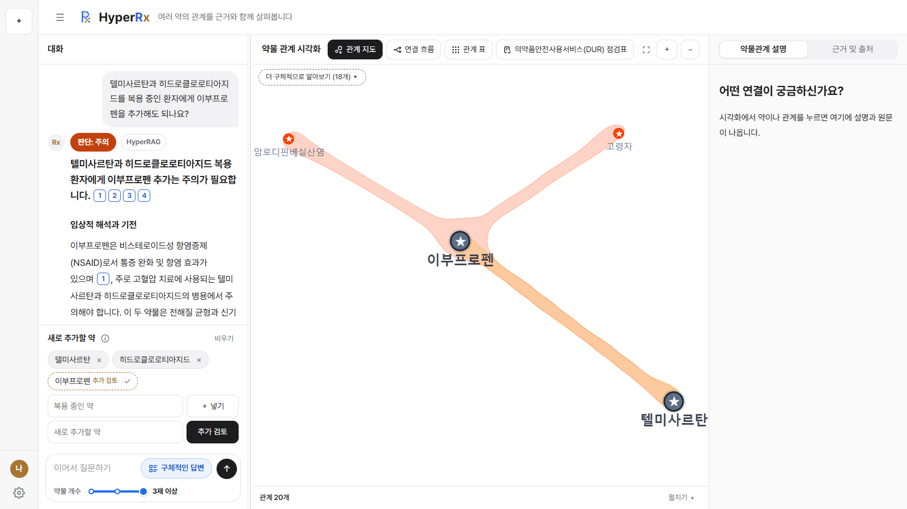

## 목차

1. [서비스 개요](#1-서비스-개요)
2. [실행 방법](#2-실행-방법)
3. [사용 방법](#3-사용-방법)
4. [저장소 구성](#4-저장소-구성)
5. [알아 둘 점](#5-알아-둘-점)

---

## 1. 서비스 개요

### 1-1. 왜 필요한가

| 현재 상황 | 생기는 문제 |
|---|---|
| 고령 환자가 늘면서 여러 진료과에서 약을 받아 **5개, 10개씩 함께 먹는 환자**(다제약물 환자)가 늘고 있습니다. | 처방하는 의사가 다른 병원에서 받은 약까지 모두 기억하고 조합을 확인하기 어렵습니다. |
| 의약품안전사용서비스(DUR)는 금기 조합을 **두 약씩** 점검합니다. | 둘씩 보면 문제가 없지만 **세 약이 함께 쓰일 때 생기는 위험**(예: 이뇨제 + RAAS 억제제 + 소염진통제의 급성 콩팥 손상, "트리플 와미")은 걸러지지 않습니다. |
| 생성형 AI(LLM)에게 직접 물으면 그럴듯한 답을 합니다. | 근거 없이 지어낸 답(환각)이 섞여도 의사가 확인할 방법이 없습니다. |

### 1-2. 누구를 위한 서비스인가

- **주 사용자: 처방하는 의사.** 진료 중에 "지금 먹는 약에 이 약을 더해도 되는가"를 빠르게 확인하고, 그 판단의 근거 원문까지 바로 읽을 수 있어야 하는 사람입니다.
- **함께 쓸 수 있는 사람: 약사, 간호사 등 의료진.** 처방을 검토하거나 복약을 상담할 때 같은 방식으로 근거를 찾을 수 있습니다.
- HyperRx는 의료진의 판단을 돕는 **근거 탐색 도구**입니다. 환자가 스스로 복용 여부를 정하는 데 쓰는 서비스가 아닙니다.

### 1-3. 무엇을 하려는가 (목적)

1. **여러 약의 조합을 한 번에 점검합니다.** 두 약씩이 아니라, 셋 이상의 약이 함께 얽힌 관계까지 찾습니다.
2. **모든 판단에 근거를 붙입니다.** 답변의 문장마다 근거 번호가 붙고, 번호를 누르면 원문에서 해당 문장이 표시됩니다.
3. **공식 기록을 AI보다 우선합니다.** DUR 병용금기나 허가사항의 투여 금지 기록이 있으면 AI 답변과 상관없이 "금기"로 표시합니다. AI는 기록에 있는 금기를 낮추지 못합니다.
4. **"근거를 못 찾음"과 "안전함"을 구분합니다.** 기록을 찾지 못하면 "근거 부족"으로 표시하고, 안전하다는 뜻이 아니라고 함께 적습니다.

### 1-4. 어떻게 해결하는가

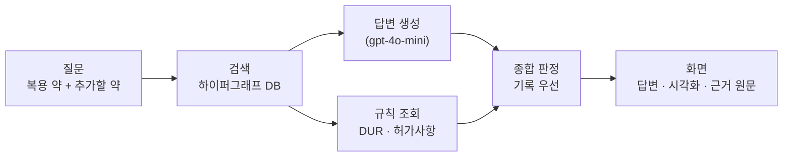

- **하이퍼그래프 검색(Hyper-RAG):** 일반 그래프는 두 개체를 한 선으로 잇지만, 하이퍼그래프는 **셋 이상의 개체를 한 관계(하이퍼엣지)로** 묶습니다. 그래서 "약 A + 약 B + 약 C + 고령 환자"처럼 여러 요소가 함께 얽힌 관계를 그대로 저장하고 검색할 수 있습니다.
- **약 개수에 따라 검색 방식을 고릅니다.** 약이 1~2개면 RAG(문서 검색), 3개 이상이면 HyperRAG(문서·개체·관계 검색)로 답합니다. 팀 평가(135문항)에서 1·2제는 RAG가, 3제 이상은 HyperRAG가 정답 일치율이 더 높았기 때문입니다.
- **규칙 조회는 AI 없이 동작합니다.** 질문에 나온 약의 DUR 기록과 허가사항 문장을 DB에서 바로 찾아 점검표로 보여 줍니다.

### 1-5. 사용하는 데이터

| 자료 | 제공처 | 내용 |
|---|---|---|
| 의약품안전사용서비스(DUR) 성분정보 | 식품의약품안전처 (공공데이터포털) | 병용금기, 임부금기, 노인주의, 용량주의, 투여기간주의, 연령금기, 효능군중복 (7개 유형) |
| 의약품 제품 허가정보 | 식품의약품안전처 (공공데이터포털) | 사용상의 주의사항, 효능효과, 용법용량 |
| 의약품개요정보(e약은요) | 식품의약품안전처 (공공데이터포털) | 일반인용 복약 정보 |
| PubMed 논문 초록 | 미국 국립의학도서관 | 약물 상호작용 관련 논문 초록 239편 |

- 이 자료로 만든 지식 베이스(DB v1.0.2)는 **원문 13,522건, 개체 47,122개, 관계(하이퍼엣지) 101,692개**입니다.
- 모든 관계는 원문과 출처에 연결되어 있어, 화면에서 원문을 바로 열어 볼 수 있습니다.

### 1-6. 주요 기능

| 기능 | 설명 |
|---|---|
| 판단 배지가 붙은 답변 | 금기 · 주의 · 확인 필요 · 근거 부족 중 하나와, 근거 번호가 붙은 임상 검토문 |
| 추가 약 검토 | 복용 중인 약 목록에 새 약을 넣으면 "A, B를 복용 중인 환자에게 C를 추가해도 되나요?" 질문을 자동으로 만듭니다. |
| 관계 시각화 4종 | 관계 지도, 연결 흐름, 관계 표, DUR 점검표 |
| 약물관계 설명 | 관계를 누르면 HyperRx의 판단과 근거 문장을 보여 줍니다. |
| 약 사전 | 약을 누르면 의약품안전나라 허가정보(성분·함량, 효능효과, 용법용량)를 보여 줍니다. |
| 근거 원문 창 | 답변의 근거 번호를 누르면 원문에서 인용된 문장을 표시합니다. |
| 시연용 답변 | 미리 저장한 실제 답변을 API 비용 없이 다시 볼 수 있습니다. |

---

## 2. 실행 방법

세 가지 방법이 있습니다. **Windows에서 바로 써 보려면 방법 A**를 권합니다.

| 방법 | 대상 | 필요한 것 |
|---|---|---|
| A. 실행파일 | Windows 사용자 | 없음 (ZIP 하나) |
| B. Docker | 서버나 Mac·Linux | Docker, DB 파일 |
| C. 소스에서 실행 | 개발자 | Node.js, Python, DB 파일 |

모든 방법에서 **실제 답변을 받으려면 OpenAI API 키**가 필요합니다. 키가 없어도 시연용 답변과 예시 데이터는 볼 수 있습니다.

### A. 실행파일 (Windows 64비트)

1. 이 저장소의 [Releases](../../releases) 페이지에서 `HyperRx_portable_win64_2026-11-12.zip`(약 1.04GB)을 내려받습니다.
   - 함께 올린 `.md5` 파일로 내려받은 파일이 온전한지 확인할 수 있습니다.
2. ZIP을 원하는 폴더에 **모두 풉니다.** ZIP 안에서 바로 실행하지 마세요.
3. `HyperRx.exe`를 더블클릭합니다.
   - 검은 창이 열리고, 10~30초 뒤 브라우저에 `http://127.0.0.1:8787/`이 자동으로 열립니다.
   - "Windows의 PC 보호" 창이 뜨면 "추가 정보" → "실행"을 누릅니다. 서명하지 않은 프로그램이라 나오는 경고입니다.
4. 화면 왼쪽 아래 **톱니바퀴(설정)**에서 OpenAI API 키를 넣고, 실행 모드를 **"실제 연결"**로 바꿉니다.
5. 끝낼 때는 검은 창을 닫습니다.

- 설치할 프로그램은 없습니다. ZIP 안에 웹 서버(Node.js), DB 검색 서버(Python), DB가 모두 들어 있습니다.
- 메모리를 약 3GB 쓰므로 8GB 이상인 컴퓨터를 권장합니다.
- 실행기 소스는 [`launcher/HyperRx.cs`](launcher/HyperRx.cs)에 있습니다.

### B. Docker

1. Releases 페이지에서 DB 파일 `kdb-v1.0.2-20261105.zip`과 `.md5`를 내려받아 `web-service/` 폴더에 넣습니다.
2. 다음 명령을 실행합니다.

```bash
cd web-service/local-app
docker compose up -d --build
```

3. 처음 시작할 때 DB를 푸는 데 몇 분이 걸립니다. 로그(`docker compose logs -f`)에 `HyperRx ready`가 나오면 `http://127.0.0.1:8787/`을 엽니다.

### C. 소스에서 실행

[`web-service/local-app/README.md`](web-service/local-app/README.md)를 따릅니다. Windows에서는 `setup-windows.cmd`가 준비 과정을 한 번에 진행합니다.

---

## 3. 사용 방법

### 3-1. 시작 화면

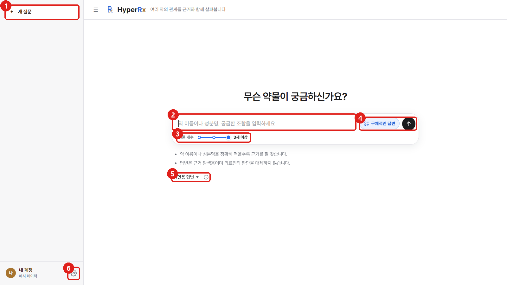

| 번호 | 이름 | 하는 일 |
|---|---|---|
| ① | 새 질문 | 대화를 비우고 처음 화면으로 돌아갑니다. |
| ② | 질문 입력창 | 약 이름이나 성분명, 궁금한 조합을 문장으로 입력합니다. 성분명을 정확히 적을수록 근거를 잘 찾습니다. |
| ③ | 약물 개수 | 질문에 나온 약 수에 따라 자동으로 맞춰집니다. 1·2제는 RAG, 3제 이상은 HyperRAG로 답합니다. |
| ④ | 구체적인 답변 / 보내기 | 켜면 답변을 항목별 검토문으로 길게, 끄면 핵심 정리만 보여 줍니다. 화살표를 누르면 질문을 보냅니다. |
| ⑤ | 시연용 답변 | 미리 실행해 저장한 실제 답변 목록입니다. 누르면 API 비용 없이 같은 답변을 다시 보여 줍니다. |
| ⑥ | 설정 | API 키, 실행 모드(예시 데이터 / 실제 연결), 테마를 바꿉니다. |

### 3-2. 답변 화면 (세 칸 구성)

질문을 보내면 화면이 왼쪽 대화, 가운데 시각화, 오른쪽 설명의 세 칸으로 바뀝니다.

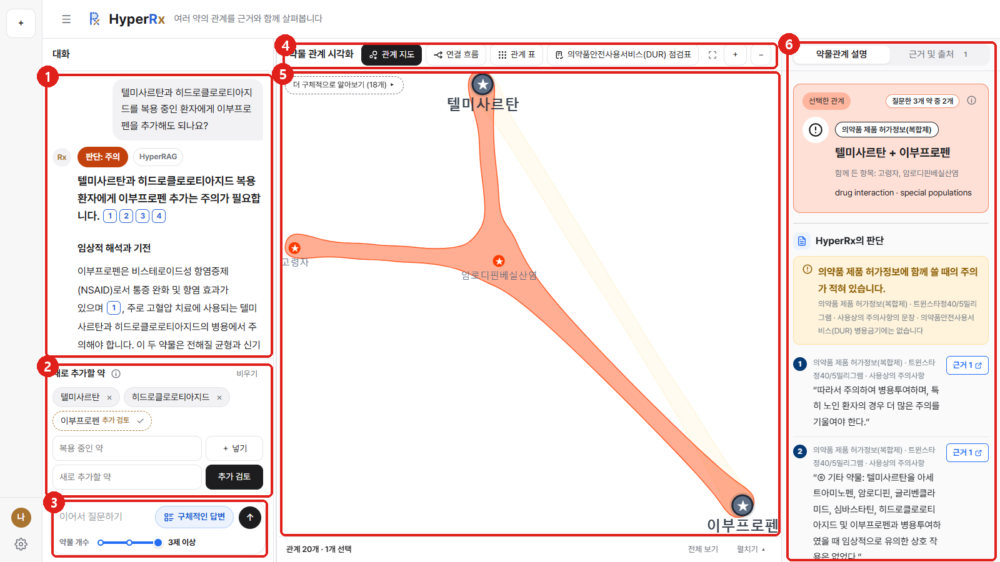

| 번호 | 이름 | 하는 일 |
|---|---|---|
| ① | 대화 | 판단 배지(금기·주의 등), 답변 방식(RAG·HyperRAG), 근거 번호가 붙은 답변이 나옵니다. |
| ② | 새로 추가할 약 | 복용 중인 약을 넣고 새로 추가할 약을 적은 뒤 "추가 검토"를 누르면 검토 질문을 자동으로 만들어 보냅니다. ✓를 누르면 추가한 약이 복용 약으로 옮겨집니다. |
| ③ | 이어서 질문하기 | 같은 대화에서 다음 질문을 입력합니다. |
| ④ | 시각화 탭 | 관계 지도, 연결 흐름, 관계 표, DUR 점검표를 고릅니다. 오른쪽 버튼은 전체 화면과 확대·축소입니다. |
| ⑤ | 시각화 영역 | 질문한 약과 그 약들이 함께 든 관계를 그립니다. 약(★)이나 관계(색 띠)를 누를 수 있습니다. |
| ⑥ | 설명 패널 | "약물관계 설명" 탭은 누른 약·관계의 설명을, "근거 및 출처" 탭은 근거 원문 목록을 보여 줍니다. |

### 3-3. 사용 흐름 예시

아래는 "텔미사르탄과 히드로클로로티아지드를 복용 중인 환자에게 이부프로펜을 추가해도 되나요?"(시연용 답변)로 본 화면입니다.

**1단계: 질문하기.** 시작 화면에 질문을 입력하거나, 왼쪽 "새로 추가할 약"에 복용 약(텔미사르탄, 히드로클로로티아지드)과 추가할 약(이부프로펜)을 넣고 "추가 검토"를 누릅니다.

**2단계: 판단 확인하기.** 대화 칸 맨 위에 판단 배지가 나옵니다. 판단은 아래 순서로 정합니다.

| 판단 | 기준 |
|---|---|
| 금기 | DUR 병용금기에 등재되었거나, 단일 성분 제품 허가사항의 투여 금지 항목에 상대 약이 적힌 경우 |
| 확인 필요 | AI는 금기로 판단했지만 금기 기록을 찾지 못했거나, AI가 자료끼리 엇갈린다고 판단한 경우 |
| 주의 | 복합제 기록만 있거나, AI 답변이 주의로 판단했거나, 허가사항에 함께 쓸 때의 주의 문장이 있는 경우 |
| 근거 부족 | DUR과 허가사항에서 금기·주의 기록을 찾지 못한 경우. 안전하다는 뜻은 아닙니다. |

**3단계: 관계 누르기.** 시각화에서 색 띠(관계)를 누르면 오른쪽에 그 관계에 대한 HyperRx의 판단과 근거 문장이 원문 그대로 나옵니다.

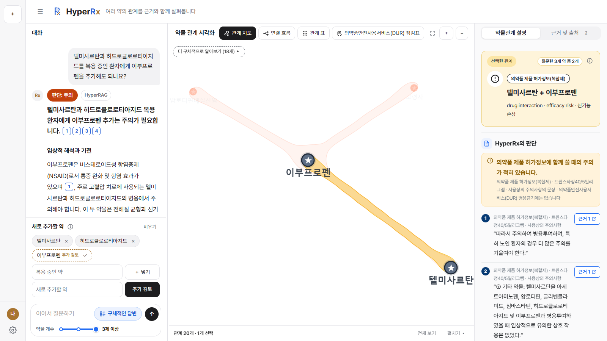

**4단계: 약 누르기.** 약(★)을 누르면 의약품안전나라 허가정보에서 제품을 골라 성분·함량, 효능효과, 용법용량을 볼 수 있습니다.

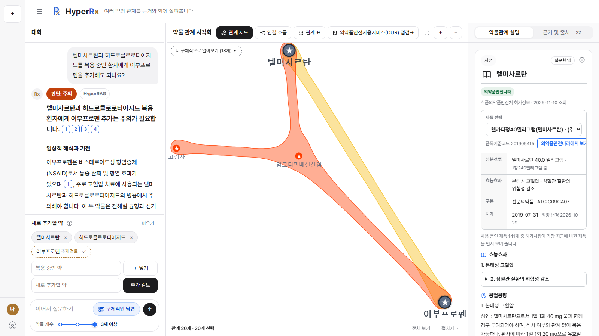

**5단계: 근거 번호 누르기.** 답변 속 네모 번호(1, 2 …)를 누르면 원문 창이 열리고, 인용된 문장이 표시됩니다. 원자료의 이름, 고시일자, 성분코드도 함께 나옵니다.

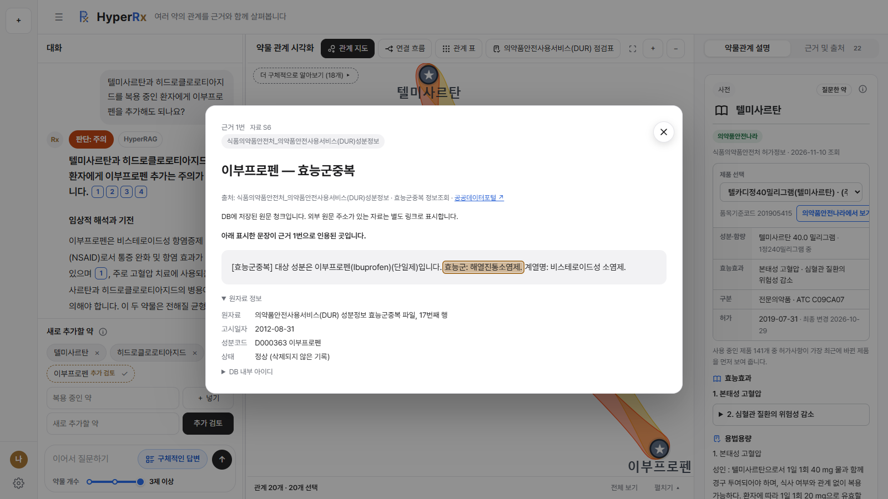

### 3-4. 시각화 4종

| 관계 지도 | 연결 흐름 |
|---|---|
|  | 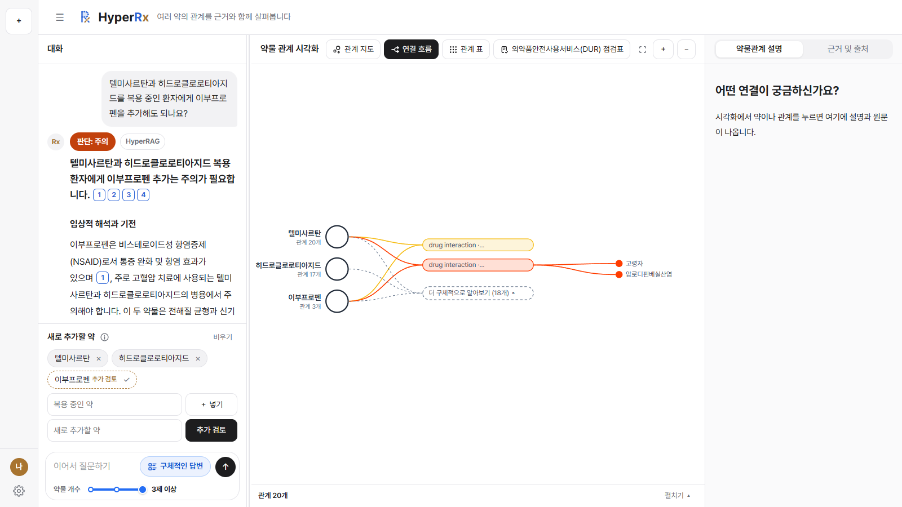 |
| 약과 관계를 색 영역으로 겹쳐 그립니다. 세 개 이상이 묶인 관계도 한 영역으로 보입니다. | 왼쪽 약에서 가운데 관계를 거쳐 오른쪽 다른 개체로 이어지는 흐름입니다. |

| 관계 표 | DUR 점검표 |
|---|---|
| 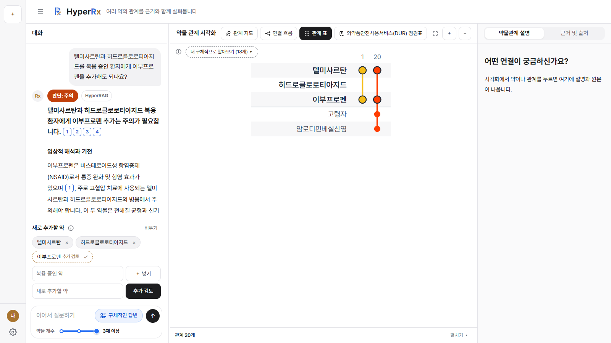 | 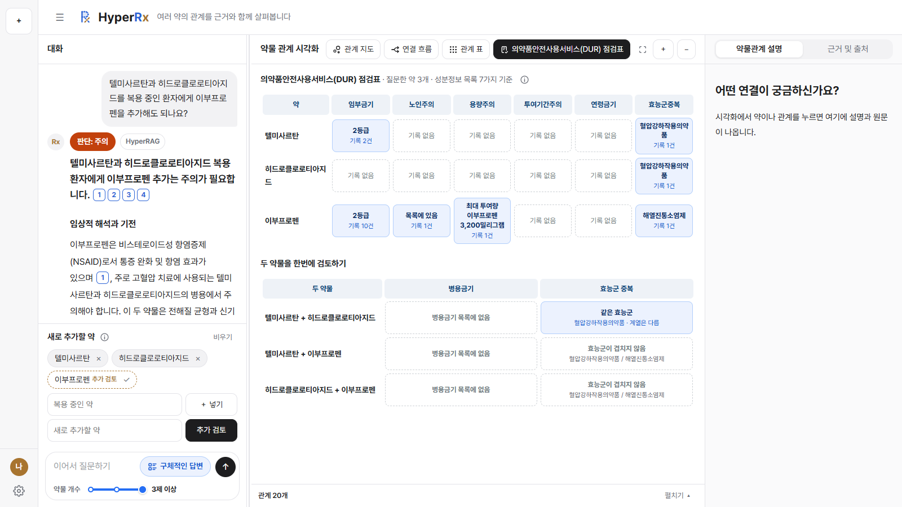 |
| 행은 약·개체, 열은 관계입니다. 점이 이어진 열이 한 관계의 구성원입니다. | 약마다 DUR 7개 유형의 기록을, 두 약씩 병용금기와 효능군 중복을 표로 보여 줍니다. AI를 쓰지 않는 규칙 조회입니다. |

### 3-5. 근거 및 출처, 설정

| 근거 및 출처 탭 | 설정 |
|---|---|
| 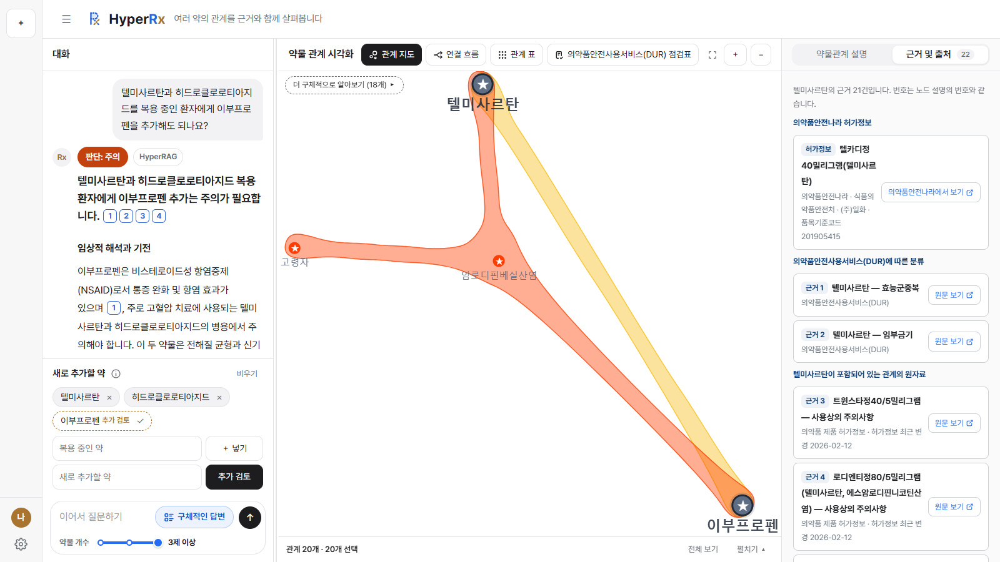 | 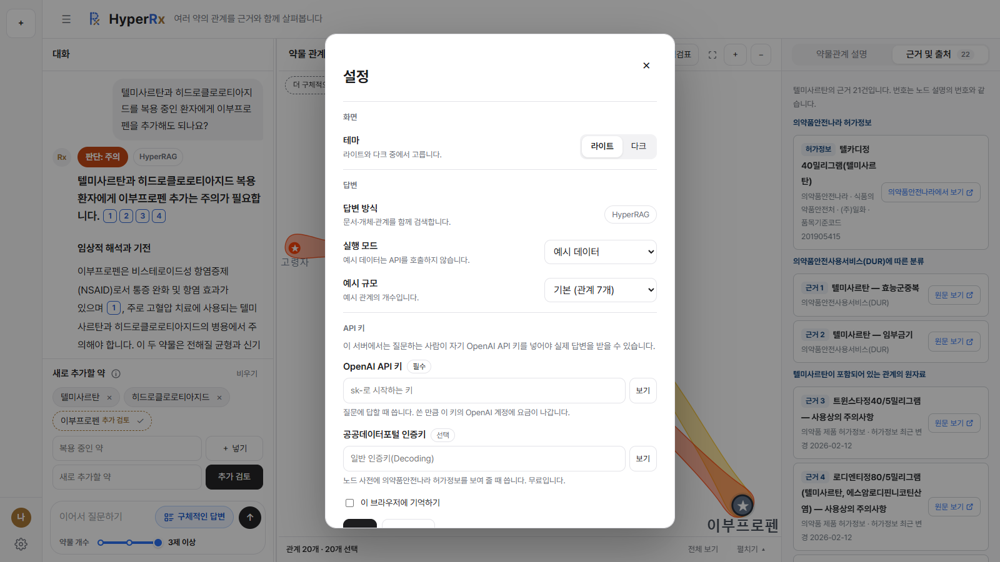 |
| 근거 원문을 자료 종류별로 모아 보여 주고, "원문 보기"로 원래 페이지를 엽니다. | OpenAI API 키(필수), 공공데이터포털 인증키(선택), 실행 모드, 테마를 정합니다. 키는 브라우저에만 저장됩니다. |

---

## 4. 저장소 구성

```
HyperRx_Final/
├── README.md                     이 문서
├── docs/images/                  실행 화면 캡처
├── launcher/                     Windows 실행기(HyperRx.exe) 소스
│   ├── HyperRx.cs
│   └── HyperRx.ico
└── web-service/
    ├── galYAKsi_smaller_sign.html  화면 빌드에 쓰는 페이지 원본
    └── local-app/                서비스 소스코드
        ├── server.mjs, service.mjs   웹 서버, 답변 생성 (Node.js)
        ├── db_server.py              DB 검색 서버 (Python, Hyper-RAG)
        ├── clinical.py               DUR·허가사항 규칙 조회
        ├── evidence.py               근거 원문과 출처 정리
        ├── src/                      화면 코드 (시각화, 판정, 패널)
        ├── public/                   화면 HTML·CSS, 시연용 답변
        ├── tests/                    테스트 (node --test)
        ├── Dockerfile, docker-compose.yml
        └── setup-windows.cmd         소스 실행 준비 스크립트
```

**실행파일과 DB**는 크기가 커서(각 약 1GB) 저장소가 아니라 [Releases](../../releases)에 올립니다.

| 파일 | 크기 | 용도 |
|---|---|---|
| `HyperRx_portable_win64_2026-11-12.zip` | 약 1.04GB | 방법 A: Windows 실행 묶음 (실행기, 서비스, Python·Node 런타임, DB) |
| `kdb-v1.0.2-20261105.zip` | 약 1.0GB | 방법 B·C: DB 파일 |

---

## 5. 알아 둘 점

- **의료 판단을 대신하지 않습니다.** HyperRx의 답변은 근거 탐색용입니다. 처방 결정은 의료진이 합니다.
- **근거가 없다는 것은 안전하다는 뜻이 아닙니다.** DB에 기록이 없으면 "근거 부족"으로 표시합니다.
- **화면의 숫자는 근거 기록의 개수입니다.** 위험 확률이나 발생률이 아닙니다.
- **한 질문의 약은 4개 이하를 권장합니다.** 약이 많을수록 검색 결과가 커져 답변 생성이 느려지거나 실패할 수 있습니다.
- **비용:** 질문 하나에 OpenAI 요금이 약 $0.004(1·2제, RAG)~$0.013(3제 이상, HyperRAG) 듭니다(gpt-4o-mini, 2026-11-12 측정).
- **API 키는 저장소에 없습니다.** 키는 사용자의 브라우저에만 저장되고, 서버는 요청을 처리하는 동안만 씁니다.
- **답변은 실행할 때마다 조금씩 다를 수 있습니다.** 같은 답변을 다시 보려면 시연용 답변을 씁니다.

### 라이선스와 출처

- Hyper-RAG 엔진: [iMoonLab/Hyper-RAG](https://github.com/iMoonLab/Hyper-RAG) (커밋 `46ff126`, 라이선스는 `web-service/local-app/licenses/Hyper-RAG-LICENSE`)
- 그 밖의 오픈소스 목록: [`web-service/local-app/THIRD_PARTY_NOTICES.md`](web-service/local-app/THIRD_PARTY_NOTICES.md)
- 공공데이터: 식품의약품안전처, 공공데이터포털(data.go.kr)
- 논문 초록: PubMed (미국 국립의학도서관)
